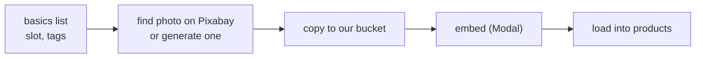

# Basics Sourcing: Design Doc (#91)

B&C sells no pants, shoes, or jackets, so the recommender can't build a full outfit from their store alone. This covers where we get basics to fill those gaps, how many we need, how they get labeled and loaded, and how B&C pieces stay ahead of them.

---

## Recommendation

**Hand-pick existing photos from Pixabay**, real or AI-generated, for a list of basics we write ourselves. We only **generate our own images** for basics we can't find there. A person checks every photo either way.

### Why Pixabay

Pixabay's license allows commercial use without attribution, and nothing in it stops us from embedding images. Its terms ban scraping and bots, so we download each photo by hand, once. Nothing calls Pixabay after that, so it can't rate-limit or block us. We pick only front-on shots on plain white or transparent backgrounds, so they sit well next to B&C's product shots, and skip anything with a visible logo, since the license doesn't allow those for commercial use.

Pixabay has plenty of shoes on white, but few jeans or trousers on their own. Pexels has similar terms, so we search it next for anything Pixabay lacks. Expect to generate some bottoms. Images we generate are ours to store and show under the image model's terms.

### Ruled out

- **Stock photos (Adobe Stock)**: the license bans any AI or machine-learning use, and we embed every image.
- **Unsplash**: its license restricts AI and machine-learning use.
- **Freepik**: the free plan requires attribution, AI images need a paid plan for commercial use, and its terms on AI use are unclear.
- **Amazon and affiliate APIs**: they require a link to the retailer and don't allow storing images.
- **Other stores' catalogs**: that's scraping, and the photos belong to them.
- **Open datasets**: the ones with clean product photos (Amazon Berkeley Objects, DeepFashion) are non-commercial only. The one that allows commercial use, a CC0 set of 5,000 clothing photos, is phone pictures of clothes lying on beds and rugs.

---

## Coverage

About 35 basics, all womenswear, in black, white, denim, camel, and grey.

- **Bottoms (12):** 5 jeans, 3 trousers, 2 skirts, 2 shorts
- **Shoes (10):** sneakers, boots, loafers, flats, pumps, sandals
- **Tops (7):** white and black tees, a button-down, a camisole, a trench, a blazer, a denim jacket
- **Accessories (6):** 2 belts, 2 bags, gold hoops, sunglasses

---

## Labels

We write each basic's slot (and category, once #86 adds it) and tags in the list, using the same tags existing products already have. An LLM drafts the tags once and a person checks them. The image comes from Pixabay, or is generated if we can't find one, and Modal embeds it when the basic is loaded. Nothing calls an LLM at load time.

---

## Loading

Basics load through **their own task, not the Shopify sync**, since they only change when the list changes. Images are **copied to our bucket, not hotlinked**, so they can't disappear. We save them as transparent PNGs, cutting out the background where a photo has one, because the canvas removes white backgrounds and would erase a white tee.



### Schema changes

A basic is a product with no Shopify ID or handle, and `is_basic` marks it:

```sql
ALTER TABLE products ALTER COLUMN shopify_id DROP NOT NULL;
ALTER TABLE products ALTER COLUMN handle DROP NOT NULL;
ALTER TABLE products ADD COLUMN is_basic BOOLEAN GENERATED ALWAYS AS (shopify_id IS NULL) STORED;
ALTER TABLE product_images ALTER COLUMN shopify_id DROP NOT NULL;
```

---

## How B&C pieces get priority

- **A small ranking penalty.** In `FindSimilar`, a basic's score gets a small penalty, so a basic only wins its slot when it's a clearly better match than every B&C piece.
- **At least one B&C piece per outfit.** If every slot's top pick is a basic, swap one for the best B&C option.

---

## Sources

- [Pixabay content license](https://pixabay.com/service/license/) and [terms](https://pixabay.com/service/terms/): commercial use, logos, and the scraping ban
- [Pexels help center](https://help.pexels.com/hc/de-de/articles/900005880463): limits on automated collection for machine learning
- [OpenAI terms of use](https://openai.com/policies/terms-of-use): ownership of generated images
- [Adobe Stock license terms](https://adobe.com/content/dam/cc/en/legal/terms/enterprise/pdfs/PSLT-Stock-WW-2022v1.pdf): the AI and machine-learning ban
- [Unsplash help center](https://help.unsplash.com/en/articles/2612332-what-do-you-mean-by-compiling-photos-to-replicate-a-similar-or-competing-service): limits on AI and machine-learning use
- [Freepik AI usage rights](https://www.freepik.com/ai/faq/legal-aspects-and-usage-rights): attribution and paid plans
- [Amazon Associates image caching policy](https://conductatlas.com/platform/amazon-associates/amazon-associates-program-policies/product-advertising-image-caching-limited-to-24-hours/) (third-party copy): no storing images
- [Amazon Berkeley Objects](https://registry.opendata.aws/amazon-berkeley-objects/) and [DeepFashion](https://mmlab.ie.cuhk.edu.hk/projects/DeepFashion.html): non-commercial licenses
- [CC0 clothing dataset](https://github.com/alexeygrigorev/clothing-dataset): the 5,000 phone photos